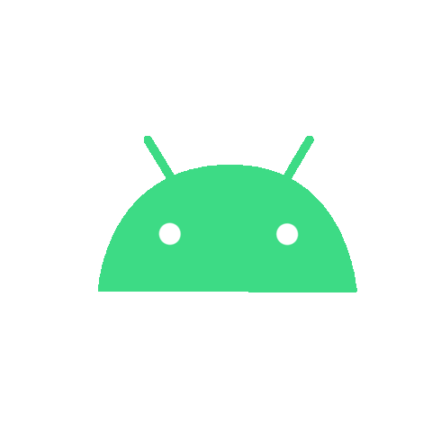

# AndroidWorld

> <!-- history-note --> **Historical project (2021-08 → 2021-10 · Android, Java).** Kept as originally built; not maintained. Part of my engineering journey: see [my profile](https://github.com/pj-25).

## History
Mobile application development coursework and experiments: Chitchat, Blogholic and the MAD practicals.

Archived on GitHub in 2026 as a read-only record. The code and commit history are unchanged. The Firebase projects behind the API keys in its history (chitchat, blogholic) were shut down in 2026-11, so those keys no longer work.
